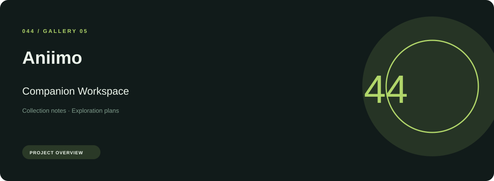
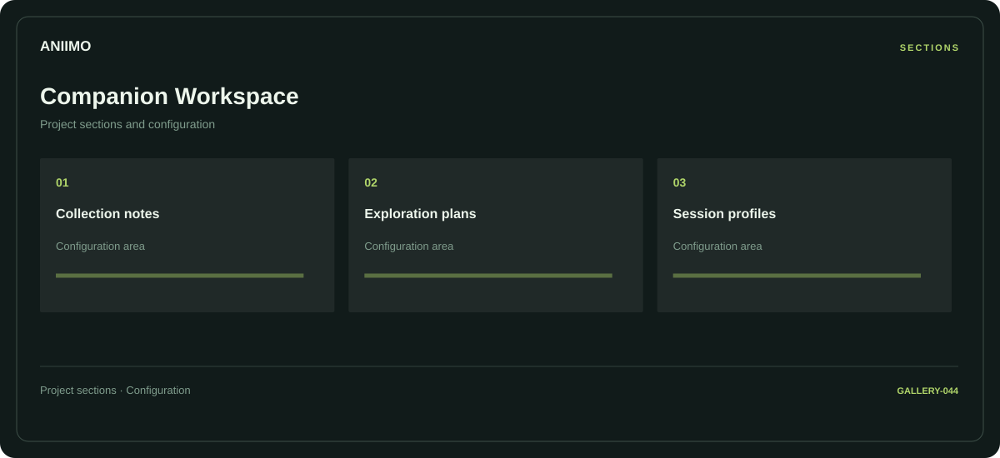

# 🛠️ Aniimo Companion Workspace

**Collection notes · Exploration plans · Session profiles**

## ⚡ Features

A companion workspace workspace for Aniimo, built around collection notes and exploration plans, with session profiles kept in a separate reference area.

### ⚙️ Collection notes

A dedicated section for collection notes and the configuration details associated with that area.

### 🧩 Exploration plans

A dedicated section for exploration plans and the configuration details associated with that area.

### ⌨️ Session profiles

Related settings collected into named groups for a clearer configuration workflow.

## 🖥️ Project navigation

## 📥 Download

The button and cover open the project's download page. Use the information supplied with the downloaded package for installation and release-specific requirements.

## 📚 Project documentation

- [Feature reference](docs/FEATURES.md)
- [Download information](docs/DOWNLOAD.md)
- [Project page](index.html)

---

Aniimo Companion Workspace · Program documentation and download information.
